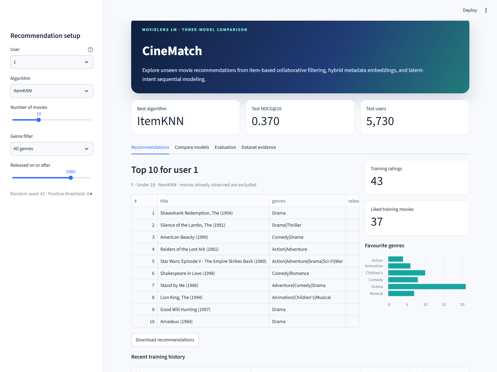

# MovieLens Hybrid Movie Recommender

A reproducible MovieLens-1M project that compares exactly three recommendation
algorithms and exposes them through an interactive Streamlit application.



## Corrected MovieLens-1M experiment

Shared test protocol: 5730 users, one held-out positive and 99 negatives each.

| Model | HR@10 | Precision@10 | NDCG@10 | MRR@10 |
|---|---:|---:|---:|---:|
| ItemKNN | 0.6414 | 0.0641 | 0.3696 | 0.2863 |
| LightFM-BPR | 0.5993 | 0.0599 | 0.3311 | 0.2492 |
| ICSRec (GRU) | 0.5375 | 0.0538 | 0.3014 | 0.2291 |

Precision@10 = HR@10 / 10; Recall@10 = HR@10. Full MRR and MRR@10 are separate columns. Equal scores follow the fixed shuffled candidate order.

## Project scope

Given an anonymized user, the system recommends at least five unseen movies and
shows titles, genres, release years, and model scores. All models use the same
users, candidates, positives, and ranking metrics.

| Role in brief | Algorithm | Main idea |
|---|---|---|
| Lecture algorithm | ItemKNN | Cosine item-item collaborative filtering over positive training interactions |
| Reference algorithm | LightFM-BPR | LightFM-style additive user/item and metadata embeddings trained with BPR pairwise ranking |
| Recent algorithm | ICSRec (GRU) | Sliding subsequences, same-target CICL pairs, false-negative masking, centroid FICL, and full-catalog CE with a GRU encoder |

The LightFM and ICSRec implementations are transparent coursework adaptations.
The report states the simplifications and does not claim an exact
state-of-the-art reproduction.

## Quick start

Python 3.11 CPU is supported.

```bash
python -m venv .venv
# Windows: .venv\Scripts\activate
# macOS/Linux: source .venv/bin/activate
python -m pip install -r requirements-resolved.txt

python scripts/prepare_data.py --download
python scripts/train_models.py
python scripts/verify_project.py
python scripts/build_report.py
streamlit run app.py
```

The Streamlit app opens at `http://localhost:8501`.

The corrected CPU run versions are listed in
`requirements-lock.txt`; the independently validated Windows/Python 3.11 environment, including transitive packages, is in `requirements-resolved.txt`.

For a fast implementation smoke test, use `python scripts/train_models.py --quick`.
Do not report quick-run metrics; the command reduces epochs and model variants.

## Data

MovieLens 1M contains approximately:

- 1,000,209 ratings from 6,040 users on 3,706 rated movies (3,883 catalog metadata rows)
- ratings on a 1-5 scale
- anonymized gender, age, occupation, and ZIP metadata for users
- title and pipe-separated genre metadata for movies

Official source: [GroupLens MovieLens 1M](https://grouplens.org/datasets/movielens/1m/)

Citation:

> F. Maxwell Harper and Joseph A. Konstan. 2015. The MovieLens Datasets:
> History and Context. ACM Transactions on Interactive Intelligent Systems,
> 5(4), Article 19. https://doi.org/10.1145/2827872

The raw data is not redistributed. Downloaded and processed files are excluded
from Git; only code, reports, figures, and result tables are committed.

## Reproducibility

- Random seed: `42`
- Rating relevance threshold: rating `>= 4`
- Split: per-user chronological `80% / 10% / 10%`
- Candidate evaluation: one latest validation/test positive plus 99 movies
  never rated by that user
- Candidate set: identical and paired across all three algorithms
- Model selection: validation `NDCG@10`, then one final test evaluation
- Maximum training sequence length: 50
- Interaction features and popularity use training data only; static metadata normalization uses the known catalog

Direct dependency versions are in `requirements-lock.txt`; the independently validated Windows/Python 3.11 environment, including transitive packages, is in `requirements-resolved.txt`. Training and test-scoring durations are separate columns in `results/metrics.csv`; selected training durations, configurations, software and seed are recorded in `results/training_info.json`.

## Outputs

| Artifact | Location |
|---|---|
| Final technical report | `docs/technical_report.pdf` |
| Report source | `docs/technical_report.md` |
| Five-minute presentation | `presentation/MovieLens_Recommender_5min.pptx` |
| Final test metrics | `results/final_test_metrics.csv` |
| All validation/test metrics | `results/metrics.csv` |
| Hyperparameter comparison | `results/hyperparameter_tuning.csv` |
| Sample recommendations | `results/sample_user_recommendations.csv` |
| EDA and result figures | `figures/` |

Trained model files are generated under `artifacts/` by the training script.

## Repository layout

```text
app.py                     Streamlit recommendation interface
scripts/prepare_data.py    Download, inspect, and preprocess data
scripts/train_models.py    Train, tune, compare, and export models
scripts/build_report.py    Generate Markdown and PDF report
src/data.py                Splits, feature engineering, candidate sampling
src/metrics.py             HR, NDCG, Precision, Recall, MRR
src/models/item_knn.py     Item-based collaborative filtering
src/models/lightfm_adapted.py
src/models/icsrec.py
tests/                     Pipeline and model-shape tests
```

## Tests

```bash
pytest -q
```

## Limitations

The project evaluates one positive item per user among 100 candidates to keep
all three algorithms comparable and computationally practical. This is not a
full-catalog online evaluation. The simplified LightFM and ICSRec adaptations
prioritize transparency and CPU reproducibility over reproducing every paper
component. Recommendations may inherit popularity bias and cannot account for
content, mood, or context outside MovieLens.

## License

Project code is released under the MIT License. MovieLens data retains its own
terms and is not covered by this license.


## Optimized algorithm setup

No pretrained checkpoint is used. LightFM includes weighted feature biases and uses BPR+Adam rather than the original logistic/Adagrad experiment. ICSRec retains all training transitions before windowing each prefix to 50 items; CPU budgets are 30000 training prefixes and 10000 clustering prefixes per epoch, sampled anew. GRU, CPU KMeans, singleton-pair handling and these caps are disclosed adaptations. Old checkpoints must be regenerated. Product examples rank the full catalog and exclude all observed ratings.

## Additional documentation

- [Installation and verification runbook](docs/runbook.md)
- [Algorithm reproduction and evaluation assumptions](docs/reproduction_notes.md)
- [Course submission checklist](docs/submission_checklist.md)
- [Five-minute presentation script](docs/presentation_script.md)
- [Review of the supplied 24-page presentation PDF](docs/presentation_review.md)

Lecture provenance and team/Canvas actions require confirmation from actual course records; no lecture page or group member has been invented. The uploaded 24-page PDF contains old results and must not replace the corrected short deck unchanged.
