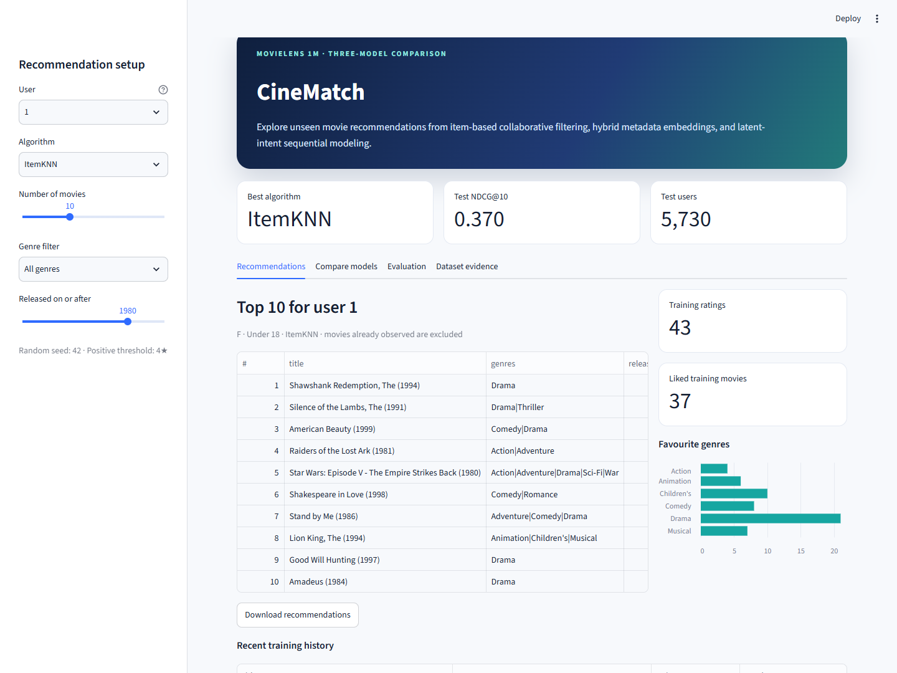

# MovieLens Hybrid Movie Recommender

A reproducible MovieLens-1M project that compares exactly three recommendation
algorithms and exposes them through an interactive Streamlit application.



## Measured result

On the shared 100-candidate held-out test set (5,730 users):

| Algorithm | HR@10 | NDCG@10 | MRR |
|---|---:|---:|---:|
| ItemKNN (120 neighbors) | 0.6415 | 0.3696 | 0.2863 |
| LightFM-adapted (32d) | 0.5640 | 0.3117 | 0.2348 |
| ICSRec-inspired (64d, 16 intents) | 0.4806 | 0.2562 | 0.1883 |

## Project scope

Given an anonymized user, the system recommends at least five unseen movies and
shows titles, genres, release years, and model scores. All models use the same
users, candidates, positives, and ranking metrics.

| Role in brief | Algorithm | Main idea |
|---|---|---|
| Lecture algorithm | ItemKNN | Cosine item-item collaborative filtering over positive training interactions |
| Reference algorithm | LightFM-adapted | LightFM-style additive user/item and metadata embeddings trained with BPR/WARP-like pairwise ranking |
| Recent algorithm | ICSRec-inspired | GRU sequence encoder with latent-intent clustering and InfoNCE alignment, trained with BPR |

The LightFM and ICSRec implementations are transparent coursework adaptations.
The report states the simplifications and does not claim an exact
state-of-the-art reproduction.

## Quick start

Python 3.10+ is recommended; the reference run used Python 3.12.

```bash
python -m venv .venv
# Windows: .venv\Scripts\activate
# macOS/Linux: source .venv/bin/activate
pip install -r requirements.txt

python scripts/prepare_data.py --download
python scripts/train_models.py
python scripts/build_report.py
streamlit run app.py
```

The Streamlit app opens at `http://localhost:8501`.

The exact versions used for the reported results are listed in
`requirements-lock.txt`.

For a fast implementation smoke test, use `python scripts/train_models.py --quick`.
Do not report quick-run metrics; the command reduces epochs and model variants.

## Data

MovieLens 1M contains approximately:

- 1,000,209 ratings from 6,040 users on 3,882 movies
- ratings on a 1-5 scale
- anonymized gender, age, occupation, and ZIP metadata for users
- title and pipe-separated genre metadata for movies

Official source: [GroupLens MovieLens 1M](https://grouplens.org/datasets/movielens/1m/)

Citation:

> F. Maxwell Harper and Joseph A. Konstan. 2015. The MovieLens Datasets:
> History and Context. ACM Transactions on Interactive Intelligent Systems,
> 5(4), Article 19. https://doi.org/10.1145/2827872

The raw data is not redistributed. Downloaded and processed files are excluded
from Git; only code, reports, figures, and result tables are committed.

## Reproducibility

- Random seed: `42`
- Rating relevance threshold: rating `>= 4`
- Split: per-user chronological `80% / 10% / 10%`
- Candidate evaluation: one latest validation/test positive plus 99 movies
  never rated by that user
- Candidate set: identical and paired across all three algorithms
- Model selection: validation `NDCG@10`, then one final test evaluation
- Maximum training sequence length: 50
- All data-derived features and popularity counts use training data only

Exact software versions and training times are written to
`results/training_info.json` and the technical report.

## Outputs

| Artifact | Location |
|---|---|
| Final technical report | `docs/technical_report.pdf` |
| Report source | `docs/technical_report.md` |
| Five-minute presentation | `presentation/MovieLens_Recommender_5min.pptx` |
| Final test metrics | `results/final_test_metrics.csv` |
| All validation/test metrics | `results/metrics.csv` |
| Hyperparameter comparison | `results/hyperparameter_tuning.csv` |
| Sample recommendations | `results/sample_user_recommendations.csv` |
| EDA and result figures | `figures/` |

Trained model files are generated under `artifacts/` by the training script.

## Repository layout

```text
app.py                     Streamlit recommendation interface
scripts/prepare_data.py    Download, inspect, and preprocess data
scripts/train_models.py    Train, tune, compare, and export models
scripts/build_report.py    Generate Markdown and PDF report
src/data.py                Splits, feature engineering, candidate sampling
src/metrics.py             HR, NDCG, Precision, Recall, MRR
src/models/item_knn.py     Item-based collaborative filtering
src/models/lightfm_adapted.py
src/models/icsrec.py
tests/                     Pipeline and model-shape tests
```

## Tests

```bash
pytest -q
```

## Limitations

The project evaluates one positive item per user among 100 candidates to keep
all three algorithms comparable and computationally practical. This is not a
full-catalog online evaluation. The simplified LightFM and ICSRec adaptations
prioritize transparency and CPU reproducibility over reproducing every paper
component. Recommendations may inherit popularity bias and cannot account for
content, mood, or context outside MovieLens.

## License

Project code is released under the MIT License. MovieLens data retains its own
terms and is not covered by this license.

