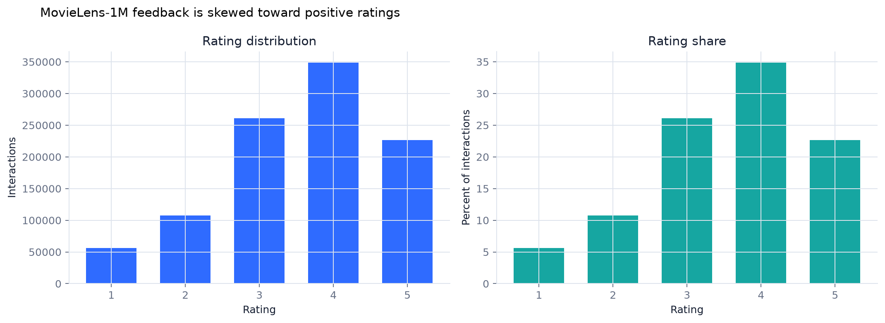
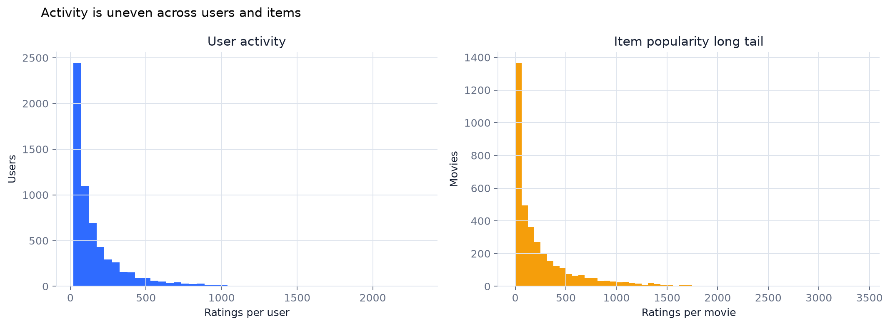
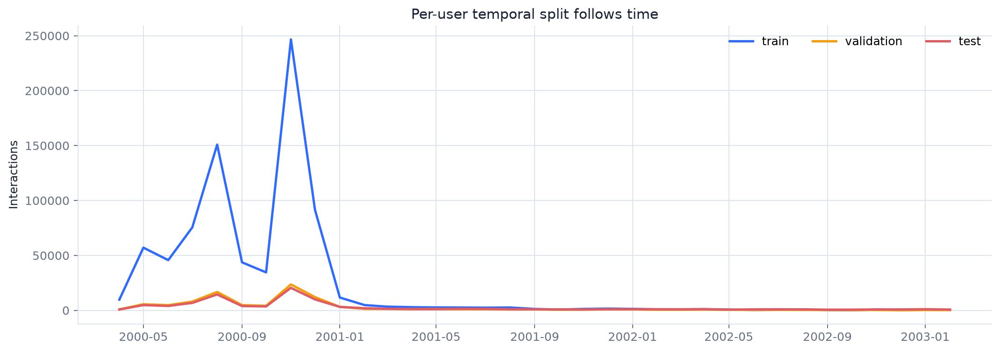
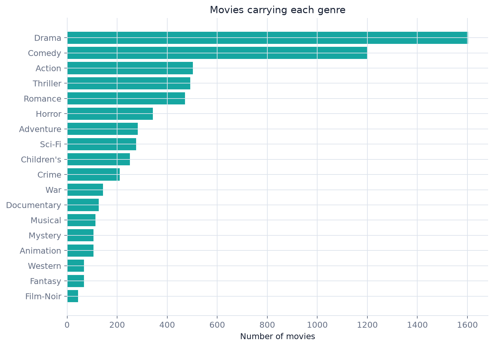
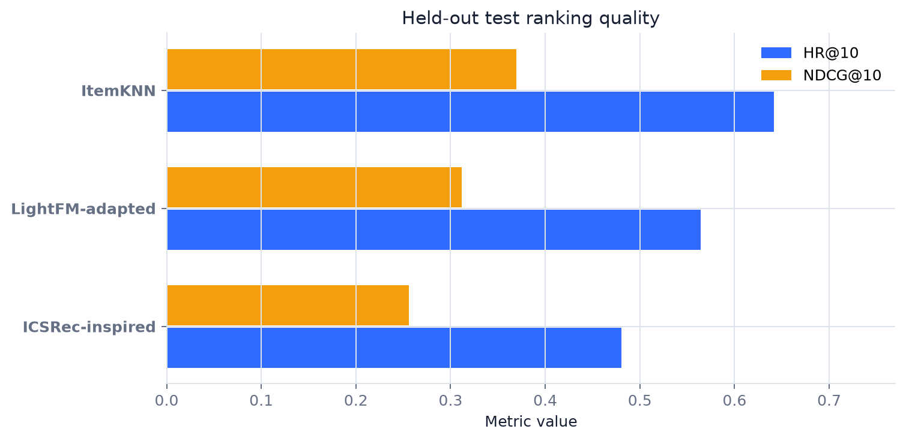

# MovieLens Hybrid Movie Recommender

**Technical report - Group Project, Project 1**

Date: 13 November 2026

## Abstract

This project builds and evaluates a movie recommendation system on the MovieLens 1M dataset. The system uses three distinct models: item-based collaborative filtering, a LightFM-style hybrid metadata factorizer, and an ICSRec-inspired sequential recommender with latent intents. All models share a per-user chronological split and identical sampled candidates. The strongest held-out test model by NDCG@10 is **ItemKNN** at 0.3696, with HR@10 of 0.6415.

The project also includes a Streamlit interface that accepts an anonymized user and displays unseen movie titles and genres.

## 1. Task and success criteria

Given a user, the recommender must rank at least five movies that the user has not rated. The deliverable must cover dataset evidence, preprocessing, exactly three algorithms, comparative evaluation, and an interactive application.

The operational success criteria are:

- Reproducible data split and random seed.
- No held-out ratings in training features or learned popularity counts.
- A shared evaluation protocol for all algorithms.
- An interface that accepts a user and shows titles and genres.

## 2. Dataset evidence

The official archive provides three relational tables.

| table | rows | columns | null cells | null columns |
| --- | --- | --- | --- | --- |
| users | 6040 | 5 | 0 | 0 |
| movies | 3883 | 3 | 0 | 0 |
| ratings | 1000209 | 4 | 0 | 0 |

Ratings range from 1 to 5 with a mean of 3.582. The tables contain 0 duplicate user-movie pairs. The source files have no missing cells, so no imputation was required. Metadata preprocessing still includes release-year extraction, genre multi-hot encoding, age standardization, and gender/occupation one-hot encoding.

The requested inspection evidence is reproduced by `scripts/prepare_data.py` in `data/processed/dataset_summary.json` and `dataset_comparison.csv`. It includes shapes, null totals, null columns, unique-value counts, dtypes, and a table comparison.





## 3. Preprocessing and split

The processed split contains 802,553 training, 100,273 validation, and 97,383 test ratings. Interactions are ordered by timestamp inside each user, then divided into 80/10/10 partitions. This prevents a future interaction from becoming a training feature. User and movie feature statistics, item popularity, sequence histories, and item-item similarities are fitted from the training partition only.

A rating of 4 or 5 is converted to a positive relevance label. For evaluation, each user contributes the latest positive rating from the relevant split plus 99 movies that the user never rated in any period. A fixed seed shuffles the 100 candidates. Hiding the future label from model fitting prevents leakage, while using the complete observed set for candidate exclusion matches the product requirement that recommendations be unseen.



## 4. Algorithms

### 4.1 Item-based collaborative filtering (lecture algorithm)

A binary user-item matrix is built from training ratings of 4 or higher. Each movie column is L2-normalized and multiplied by the transpose to obtain cosine item-item similarity. A user's score for an unseen movie is the sum of similarities from movies the user liked, plus a small normalized log-popularity prior. Neighbor counts of 30, 60, and 120 are compared on validation NDCG@10.

### 4.2 LightFM-style metadata embeddings (reference algorithm)

The LightFM paper represents users and items as additive sums of identity and metadata embeddings. This implementation follows that decomposition:

`score(u,i) = b_u + b_i + <e_u + F_u w_u, e_i + F_i w_i>`

User metadata includes standardized age plus gender and occupation indicators. Item metadata includes genre indicators and standardized release year. The model is trained with Bayesian Personalized Ranking (BPR), which increases the margin between an observed positive and a uniformly sampled unobserved negative. Embedding dimensions 32 and 64 are compared on validation NDCG@10.

### 4.3 ICSRec-inspired latent-intent sequence model (recent algorithm)

This is a compact coursework adaptation of ICSRec (WSDM 2024). A GRU encodes up to the last 50 positive training items. KMeans refreshes 8 or 16 intent clusters from the current sequence representations. An InfoNCE objective aligns each sequence with its assigned latent-intent prototype, while a BPR next-item loss trains item ranking. The simplification avoids multi-view augmentation and full paper-scale training; it retains intent clustering and contrastive alignment.



## 5. Evaluation protocol

Every algorithm receives the same users, positive items, 99 negatives, and random order. Metrics are:

- **HR@10:** whether the positive appears in the top 10.
- **NDCG@10:** position-sensitive ranking quality.
- **MRR:** reciprocal rank of the positive.
- **Precision@10 / Recall@10:** both equal HR@10 in this one-positive protocol.

Hyperparameters are selected using validation data only. The selected configuration is evaluated once on the test partition. No test metric is used for model selection.

## 6. Results

| algorithm | HR@10 | NDCG@10 | MRR | test_users |
| --- | --- | --- | --- | --- |
| ItemKNN | 0.6415 | 0.3696 | 0.2863 | 5730 |
| LightFM-adapted | 0.5640 | 0.3117 | 0.2348 | 5730 |
| ICSRec-inspired | 0.4806 | 0.2562 | 0.1883 | 5730 |



Validation selection table:

| algorithm | config | HR@10 | NDCG@10 | MRR |
| --- | --- | --- | --- | --- |
| ItemKNN | {"neighbors": 30, "popularity_weight": 0.02} | 0.6999 | 0.4204 | 0.3344 |
| ItemKNN | {"neighbors": 60, "popularity_weight": 0.02} | 0.7132 | 0.4300 | 0.3428 |
| ItemKNN | {"neighbors": 120, "popularity_weight": 0.02} | 0.7106 | 0.4314 | 0.3455 |
| LightFM-adapted | {"batch_size": 4096, "embedding_dim": 32, "epochs": 10, "learning_rate": 0.01, "loss": "BPR"} | 0.6186 | 0.3520 | 0.2706 |
| LightFM-adapted | {"batch_size": 4096, "embedding_dim": 64, "epochs": 10, "learning_rate": 0.01, "loss": "BPR"} | 0.6113 | 0.3449 | 0.2634 |
| ICSRec-inspired | {"batch_size": 256, "embedding_dim": 32, "epochs": 6, "learning_rate": 0.003, "loss": "BPR + intent InfoNCE", "n_intents": 8} | 0.5079 | 0.2730 | 0.2018 |
| ICSRec-inspired | {"batch_size": 256, "embedding_dim": 64, "epochs": 6, "learning_rate": 0.003, "loss": "BPR + intent InfoNCE", "n_intents": 16} | 0.5059 | 0.2745 | 0.2042 |

## 7. Interpretation and error analysis

The best test NDCG@10 is 0.3696. The result should be read as performance on a controlled 100-candidate task rather than full-catalog quality. A score below one is expected because the positive is one item among 99 plausible alternatives and many users have broad tastes.

ItemKNN is transparent and learns local co-consumption patterns, but its dense movie-to-movie neighborhoods can over-reward mainstream films with many co-raters. The LightFM-style model uses genre and user metadata, which helps generalize when direct interaction data is sparse. The intent model conditions on sequence order; it can capture changing preferences, but its small CPU budget and short history limit temporal depth.

Concrete error modes are:

- **Popularity bias:** common genres and frequently rated movies have more neighbors and stronger prior support.
- **Sparse users:** users with few positives provide weak collaborative and sequence evidence.
- **Cold items:** movies with few training ratings have unstable item-item neighbors but can still receive metadata scores.
- **Taste drift:** one static user representation cannot fully separate genres watched in different periods.
- **Ratings below 4:** the current implicit formulation discards future low ratings during fitting. A future version should model graded negative feedback.

## 8. Recommendation examples

The following is a sample from `results/sample_user_recommendations.csv`. The full file contains 20 users and top-10 recommendations from all three algorithms.

| user_id | algorithm | rank | title | genres | release_year |
| --- | --- | --- | --- | --- | --- |
| 521 | ItemKNN | 1 | Deliverance (1972) | Adventure|Thriller | 1972 |
| 521 | ItemKNN | 2 | Taxi Driver (1976) | Drama|Thriller | 1976 |
| 521 | ItemKNN | 3 | Boogie Nights (1997) | Drama | 1997 |
| 521 | ItemKNN | 4 | Where Eagles Dare (1969) | Action|Adventure|War | 1969 |
| 521 | ItemKNN | 5 | Jerry Maguire (1996) | Drama|Romance | 1996 |
| 521 | ItemKNN | 6 | Breakfast Club, The (1985) | Comedy|Drama | 1985 |
| 521 | ItemKNN | 7 | Get Shorty (1995) | Action|Comedy|Drama | 1995 |
| 521 | ItemKNN | 8 | Atlantic City (1980) | Crime|Drama|Romance | 1980 |
| 521 | ItemKNN | 9 | Westworld (1973) | Action|Sci-Fi|Thriller|Western | 1973 |
| 521 | ItemKNN | 10 | What's Eating Gilbert Grape (1993) | Drama | 1993 |
| 521 | LightFM-adapted | 1 | Atlantic City (1980) | Crime|Drama|Romance | 1980 |
| 521 | LightFM-adapted | 2 | Dangerous Liaisons (1988) | Drama|Romance | 1988 |
| 521 | LightFM-adapted | 3 | Taxi Driver (1976) | Drama|Thriller | 1976 |
| 521 | LightFM-adapted | 4 | Breaking Away (1979) | Drama | 1979 |
| 521 | LightFM-adapted | 5 | Westworld (1973) | Action|Sci-Fi|Thriller|Western | 1973 |
| 521 | LightFM-adapted | 6 | Boogie Nights (1997) | Drama | 1997 |
| 521 | LightFM-adapted | 7 | My Life as a Dog (Mitt liv som hund) (1985) | Drama | 1985 |
| 521 | LightFM-adapted | 8 | Cat Ballou (1965) | Comedy|Western | 1965 |

## 9. Application

The Streamlit application accepts a user, algorithm, genre, release-year filter, and result count. It excludes every movie observed for that user, displays the top titles and genres, compares the three algorithms side by side, and exposes validation/test metrics and dataset evidence. Users can download their result table as CSV.

## 10. Limitations and future work

The main limitation is sampled evaluation. A production system should rank the full unseen catalog and measure recall, NDCG, catalog coverage, and novelty. The project does not model repeated viewing, time decay, user text reviews, or item content beyond genre/year. The LightFM and ICSRec methods are transparent adaptations rather than exact paper reproductions. Future work should add graded feedback, popularity calibration, cold-start stress tests, and online A/B tests.

## 11. Reproducibility

Random seed: `42`. Positive threshold: `4`. Selected configurations: `{"ICSRec-inspired": {"batch_size": 256, "embedding_dim": 64, "epochs": 6, "learning_rate": 0.003, "loss": "BPR + intent InfoNCE", "n_intents": 16}, "ItemKNN": {"neighbors": 120, "popularity_weight": 0.02}, "LightFM-adapted": {"batch_size": 4096, "embedding_dim": 32, "epochs": 10, "learning_rate": 0.01, "loss": "BPR"}}`.

Reference environment: Python 3.12, pandas 3.1.1, NumPy 2.2.6, PyTorch, Streamlit, matplotlib, SciPy, and PyArrow. Run instructions, dependencies, seeds, data citation, and output locations are in `README.md`.

Data files are intentionally excluded from Git. Rebuild with:

```bash
python scripts/prepare_data.py --download
python scripts/train_models.py
python scripts/build_report.py
streamlit run app.py
```

## References

1. F. Maxwell Harper and Joseph A. Konstan. 2015. The MovieLens Datasets: History and Context. ACM TiiS 5(4), Article 19. https://doi.org/10.1145/2827872
2. Maciej Kula. 2015. Metadata Embeddings for User and Item Cold-start Recommendations (LightFM). arXiv:1507.08439.
3. Xiuyuan Qin et al. 2024. Intent Contrastive Learning with Cross Subsequences for Sequential Recommendation (ICSRec). WSDM 2024. https://doi.org/10.1145/3616855.3635773
